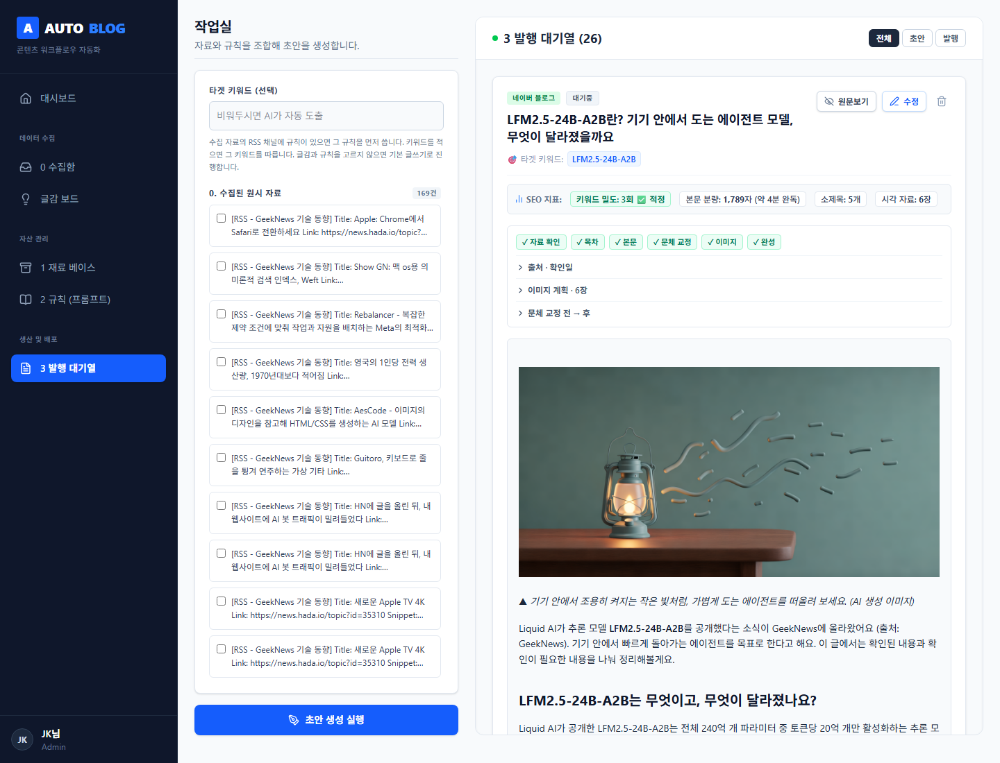
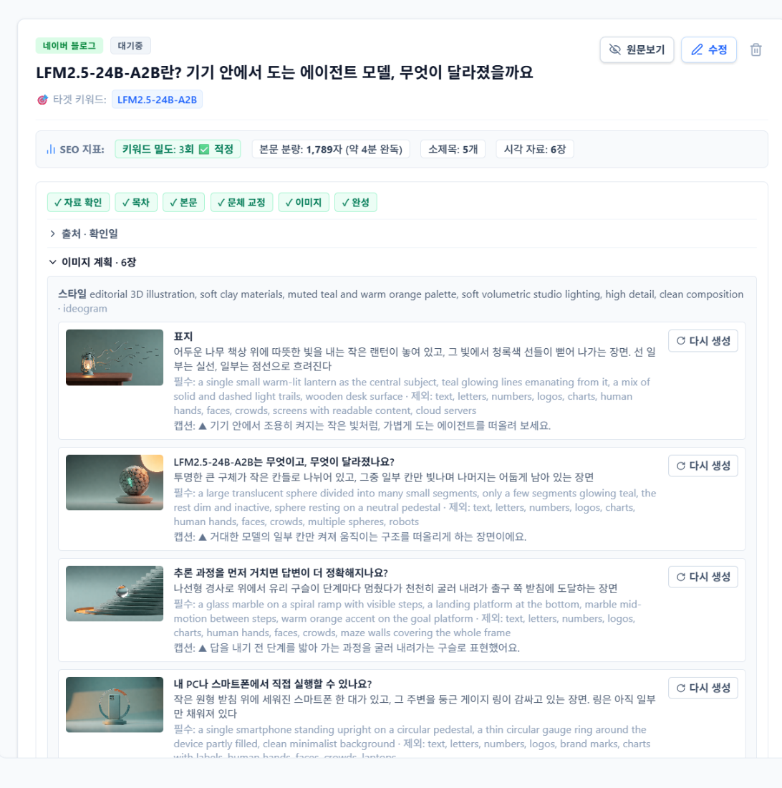
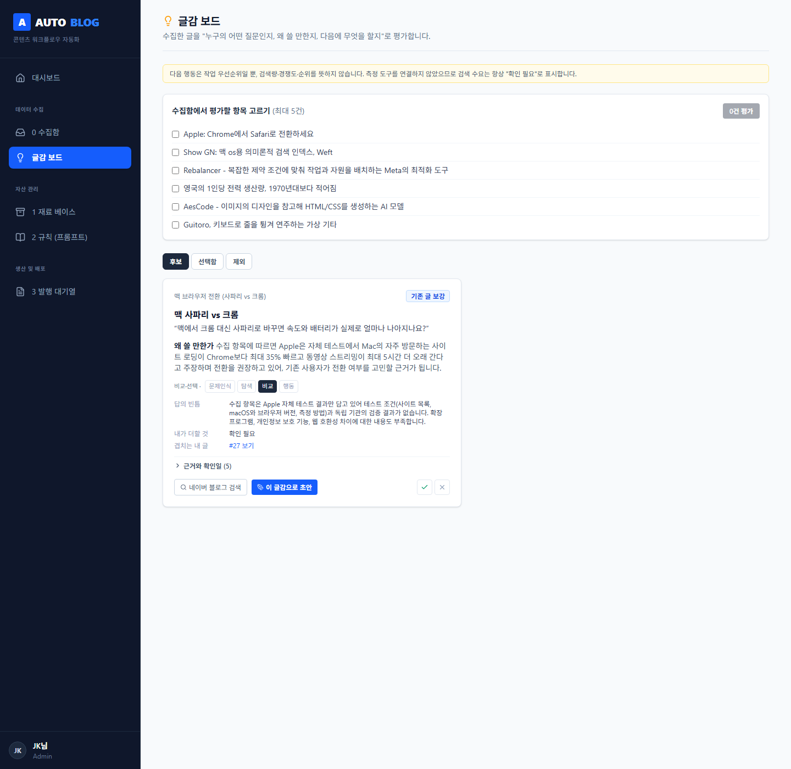
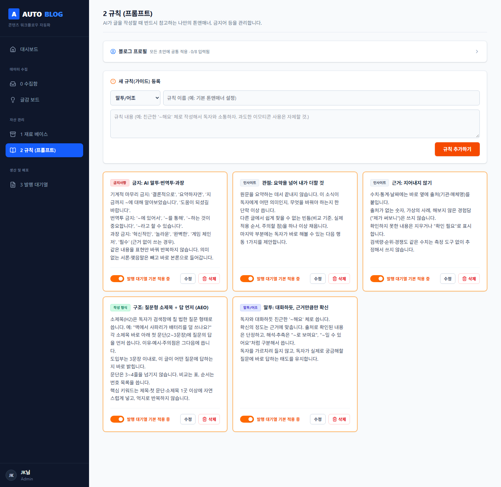
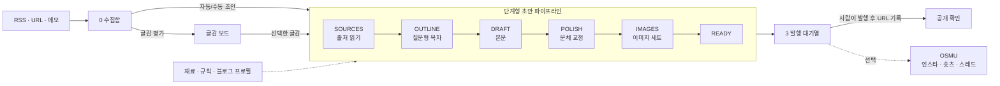

# 19auto-blog

RSS·URL·메모로 모은 글감을 **근거가 있는 블로그 초안**으로 만들어 주는 개인용 콘텐츠 자동화 도구입니다.
초안은 한 번에 쓰지 않고 **출처 → 목차 → 본문 → 문체 교정 → 이미지** 단계로 나눠 저장하므로, 중간에 실패해도 그 단계부터 다시 이어갑니다.

[](https://vercel.com/new/clone?repository-url=https%3A%2F%2Fgithub.com%2FMillion-IMP%2F19auto-blog&project-name=19auto-blog&env=ANTHROPIC_API_KEY,CRON_SECRET,APP_PASSWORD,DB_PUSH_ON_BUILD&envDescription=ANTHROPIC_API_KEY%EB%8A%94%20%ED%95%84%EC%88%98.%20DB_PUSH_ON_BUILD%EB%8A%94%201%EB%A1%9C%20%EB%91%90%EC%84%B8%EC%9A%94.&envLink=https%3A%2F%2Fgithub.com%2FMillion-IMP%2F19auto-blog%23vercel%EC%97%90-%EB%B0%B0%ED%8F%AC%ED%95%98%EA%B8%B0)

> GPTers 24기 「콘텐츠 발행 자동화」 강의에서 배운 원칙(단계형 파이프라인, 근거 구분, 이미지 세트 통일, 발행 확인)을 적용했습니다.

---

## 무엇을 하나요

| 화면 | 하는 일 |
|---|---|
| **대시보드** | 수집·초안·발행 현황, 자동 작성 설정(매일 09:00 KST), "지금 한 바퀴" 실행 |
| **0 수집함** | RSS 피드, URL 스크랩, 메모를 모읍니다. 항목을 골라 바로 초안을 만들거나 글감 평가를 보냅니다 |
| **글감 보드** | 수집 항목을 *독자 질문 · 검색 의도 · 빈틈 · 내가 더할 것 · 다음 행동* 카드로 평가합니다. 기존 글과 겹치면 "기존 글 보강"을 제안합니다 |
| **1 재료 베이스** | 글 구조 템플릿 (IT 뉴스 해설형, 질문-답 정보형, 비교·선택형, 단계별 가이드형 등) |
| **2 규칙** | 말투·형식·금지 표현·근거 규칙 + **블로그 프로필**(독자, 목적, 톤, CTA, 이미지 스타일) |
| **3 발행 대기열** | 단계 진행 표시, 이어하기, 출처·교정 내역·이미지 계획 확인, 장면별 이미지 재생성, 발행 기록과 공개 확인 |

### 화면

| 단계형 초안 + 이미지 캡션 | 이미지 계획 (장면별 다시 생성) |
|---|---|
|  |  |
| **글감 보드** | **규칙 (근거·형식·금지 표현)** |
|  |  |

### 핵심 원칙
- **지어내지 않기** — 수치 옆에는 출처를 붙이고, 출처 없는 숫자·경험담은 쓰지 않습니다. 확인하지 못한 내용은 `확인 필요`로 표시합니다. 검색량·경쟁도는 측정 도구가 없으므로 항상 `UNVERIFIED`로 둡니다.
- **질문형 소제목 + 답 먼저 (AEO)** — H2는 독자가 검색할 질문 형태, 그 아래 첫 문단에 답을 씁니다.
- **이미지는 글 단위로 통일** — 스타일 하나, 표지 1장 + 소제목마다 1장, 겹치는 장면은 다시 계획합니다. 이미지 아래에 `▲ 설명 (AI 생성 이미지)` 캡션이 붙습니다.
- **"파일 생성"은 "발행 완료"가 아님** — 발행은 사람이 기록하고, 중복 발행을 막으며, 공개된 네이버 글을 열어 제목·이미지를 확인합니다. 자동 발행은 하지 않습니다.

---

## 작동 흐름



- 각 단계 결과는 DB에 저장됩니다. 실패하면 `stageError`가 남고, **이어하기**는 그 단계부터 다시 시작합니다.
- Vercel 함수 시간 제한(`vercel.json` maxDuration 300초, Fluid compute 필요) 안에서 끝내기 위해 한 번의 실행은 280초까지만 쓰고, 남은 단계는 다음 실행(크론 또는 이어하기)이 이어갑니다. 보통 한 번에 READY까지 갑니다.
- 크론과 수동 실행이 같은 글을 동시에 처리하지 않도록 DB 잠금(`lockedUntil`)을 씁니다.

---

## 기술 스택

| 영역 | 사용 |
|---|---|
| 백엔드 | Express 5, Prisma 5 (로컬 SQLite / 배포 Postgres) |
| 프론트엔드 | React 19, Vite, Tailwind CSS 4 |
| AI | Anthropic Claude (`ANTHROPIC_MODEL`, 기본 `claude-haiku-5-5`) |
| 이미지 | 구독 Gemini (운영자 PC의 Antigravity CLI가 만들어 올림, 선택) 또는 pollinations (무료 기본값) |
| 배포 | Vercel 함수 + Vercel Cron + Vercel Blob, Neon Postgres |

```
api/server.ts           Vercel 함수 진입점 (vercel.json rewrite로 /api/* 전부 수신)
api/cron/daily.ts       Vercel 크론 (매일 00:00 UTC = 09:00 KST)
backend/src/index.ts    Express 라우트 전체
backend/src/auth.ts     비밀번호 접근 제한
backend/src/services/   aiService · draftPipeline · imageProvider · topicService · publishService · automationService
backend/prisma/         schema.prisma (SQLite 기준, Postgres 스키마는 자동 생성)
frontend/src/           pages/ (화면), components/ (PipelinePanel, LoginGate 등)
scripts/                start.js (로컬 실행), prepare-db.js (DB 준비), image-jobs.js (이미지 작업 받기·만들기·올리기)
```

---

## 로컬에서 실행하기 (약 3분)

필요한 것: Node.js 20 이상, [Anthropic API 키](https://console.anthropic.com/)

1. 저장소를 복제합니다.
   ```bash
   git clone https://github.com/Million-IMP/19auto-blog.git
   cd 19auto-blog
   ```
2. `backend/.env.example`을 `backend/.env`로 복사하고 `ANTHROPIC_API_KEY`를 넣습니다.
3. 실행합니다. 의존성 설치, DB 준비, 백엔드(3001)·프론트(5173) 실행을 한 번에 합니다.
   ```bash
   npm start
   ```
4. 브라우저에서 http://localhost:5173 을 엽니다.

- `DATABASE_URL`이 없으면 로컬 SQLite 파일(`backend/prisma/dev.db`)을 씁니다.
- ⚠️ `backend/.env`에 Postgres `DATABASE_URL`이 있으면 `npm start`가 그 DB에 구조를 반영합니다. 운영 DB를 건드리지 않으려면 `DATABASE_URL= npm start`(Git Bash/macOS/Linux)로 실행하세요.

---

## Vercel에 배포하기

### 1) 버튼으로 시작 (약 10분)
1. 위의 **Deploy with Vercel** 버튼을 누릅니다. 저장소가 내 GitHub로 복제되고 Vercel 프로젝트가 만들어집니다.
2. 환경변수 입력 화면에서:
   - `ANTHROPIC_API_KEY` — 필수
   - `CRON_SECRET` — 아무 긴 문자열 (크론 호출 확인용)
   - `APP_PASSWORD` — 운영자 비밀번호 (사용후기 삭제용. 사이트 접속은 누구나 가능)
   - `DB_PUSH_ON_BUILD` — `1`
3. 첫 배포가 끝나면 Vercel 대시보드 → **Storage → Neon(Postgres) 추가** → 프로젝트에 연결합니다. `DATABASE_URL`이 자동으로 들어갑니다.
4. **Settings → Environment Variables**에 `DIRECT_URL`을 추가하고 값으로 `DATABASE_URL_UNPOOLED`의 값을 넣습니다.
5. **Deployments → Redeploy**. 빌드 중에 DB 테이블이 자동으로 만들어집니다.

### 2) 이미지 작업 폴더 쓰기 (선택, API 요금 없음)
서버는 그림을 만들지 않고 장면별 "이미지 작업"만 남깁니다. 본문은 계속 완성되고, 대시보드에 "이미지 대기 N장"이 보입니다. 그림은 PC에서 채워 올립니다.

1. Vercel **Storage → Blob 만들기 → 프로젝트 연결** (`BLOB_READ_WRITE_TOKEN` 자동 등록). 올린 그림을 Blob에 저장합니다.
2. 환경변수 `IMAGE_PROVIDER=jobs`를 넣고 다시 배포합니다.
3. PC에서 채웁니다. 올리기는 운영자 전용이라 먼저 PowerShell에서 `$env:APP_PASSWORD = Read-Host`로 비밀번호를 넣습니다.
   - **자동**: Antigravity CLI(`agy`)에 구독 계정으로 로그인한 뒤 `npm run image-jobs -- run` (받기 → `agy`로 장면마다 1장 생성 → 올리기)
   - **수동**: `npm run image-jobs -- pull` → `image-jobs/pending/<글>-<장면>.txt`의 프롬프트로 Gemini 앱 등에서 그림 생성 → `image-jobs/done/<글>-<장면>.png`(또는 .jpg·.webp)로 저장 → `npm run image-jobs -- push`
4. 글의 마지막 장면이 올라가면 본문에 그림이 들어가고 발행 대기(READY)로 넘어갑니다. "다시 생성"은 그 장면을 다시 작업으로 돌리고, 새 그림이 올라올 때까지 이전 그림을 둡니다.

| PC 환경변수 | 기본 | 설명 |
|---|---|---|
| `IMAGE_JOBS_URL` | `https://19auto-blog.vercel.app` | 작업을 받고 올릴 서버 (로컬 검증은 `http://localhost:3001`) |
| `IMAGE_JOBS_MAX` | `6` | `generate`가 한 번에 만들 최대 장수 (구독 사용량) |
| `IMAGE_JOBS_TIMEOUT_SEC` | `180` | 장면 하나를 기다리는 시간 |
| `APP_PASSWORD` | | 운영자 비밀번호 (출력·저장하지 않음) |

### 3) 매시간 자동 실행 (GitHub Actions)
Vercel Hobby 크론은 하루 1회까지라, 초안 1건(6단계)을 끝내는 데 며칠이 걸립니다. `.github/workflows/hourly-cron.yml`이 매시간 7분에 `/api/cron/daily`를 호출해 수집과 단계 진행을 이어갑니다.

```bash
gh secret set CRON_SECRET          # Vercel의 CRON_SECRET과 같은 값
gh variable set APP_URL --body "https://<내 프로젝트>.vercel.app"
gh workflow run hourly-cron.yml    # 바로 한 번 실행해 확인
```

- GitHub 스케줄은 몇 분씩 늦게 실행될 수 있습니다.
- 저장소에 60일 동안 커밋이 없으면 GitHub가 예약 실행을 멈춥니다. Actions 탭에서 다시 켜면 됩니다.

### 4) 이후 배포
GitHub와 연결된 Vercel 프로젝트는 `master`에 푸시하면 자동으로 운영 배포되고, PR마다 미리보기 배포가 만들어집니다.

---

## 환경변수

| 이름 | 필수 | 설명 |
|---|---|---|
| `ANTHROPIC_API_KEY` | ✅ | Claude API 키 |
| `ANTHROPIC_MODEL` | | 기본 `claude-haiku-5-5` |
| `DATABASE_URL` | 배포 시 ✅ | Postgres 주소. 없으면 로컬 SQLite |
| `DIRECT_URL` | | 풀링 없는 Postgres 주소 (없으면 `DATABASE_URL`) |
| `DB_PUSH_ON_BUILD` | | `1`이면 Vercel 빌드 때 DB 구조 반영. 데이터가 지워지는 변경은 Prisma가 거부해 빌드가 멈춥니다 |
| `CRON_SECRET` | 배포 시 권장 | 크론 호출 확인 (Vercel 크론 · GitHub Actions 공통) |
| `APP_PASSWORD` | 배포 시 권장 | 운영자 비밀번호. 사용후기 삭제에 필요 (쿠키 30일). 사이트 접속은 누구나 가능 |
| `IMAGE_PROVIDER` | | `jobs`(PC에서 그림을 채워 올림) 또는 비움(pollinations) |
| `BLOB_READ_WRITE_TOKEN` | Vercel + jobs | 올린 그림을 저장할 Vercel Blob 토큰 |
| `DISABLE_LOCAL_CRON` | | `1`이면 로컬 node-cron(매시 정각) 끔 |

---

## 개발

```bash
# 백엔드 타입체크
npx --prefix backend tsc --noEmit --esModuleInterop --skipLibCheck backend/src/index.ts
# 프론트 린트 / 빌드
npm run lint --prefix frontend
npm run build --prefix frontend
```

- DB 구조는 `backend/prisma/schema.prisma`만 수정합니다. Postgres용 스키마는 `scripts/prepare-db.js`가 만듭니다.
- 새 파이프라인 단계를 추가할 때는 `draftPipeline.ts`의 `STAGES`·`runStage`와 프론트 `PipelinePanel`의 단계 목록을 함께 고칩니다.

## 알려진 제한
- 서버가 URL을 가져올 때 내부망 주소는 막지만, 리다이렉트·DNS 리바인딩까지는 막지 않습니다.
- 접근 제한은 공용 비밀번호 하나입니다(사용자 계정 없음).
- 테스트 러너가 아직 없습니다. 변경 후에는 위 검증 명령과 화면 확인으로 검증합니다.
